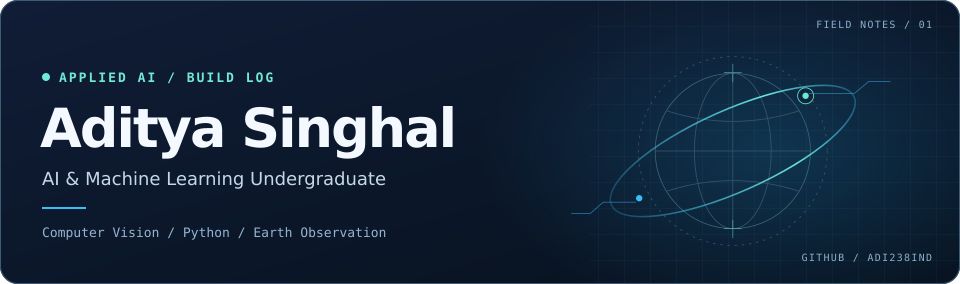

# Aditya Singhal

I'm an AI & Machine Learning undergraduate at KIET. I build computer vision and applied AI tools, with a focus on helping people inspect the evidence behind an answer.

[LinkedIn](https://www.linkedin.com/in/aditya-singhal-922a4827b/) · [Try AccessTrail](https://accesstrail.vercel.app) · [Watch GeoAlibi](https://youtu.be/mj2dss_nWP0)

## `01 / Selected builds`

### AccessTrail · Accessibility research with traceable sources
A live app that checks published venue information against a visitor's access needs. It organizes citations, restrictions, and open questions into a visit brief. I built the TinyFish research workflow, source rechecks, and report export.

[Try the app](https://accesstrail.vercel.app) · [Read the source](https://github.com/ADI238IND/accesstrail)

### GeoAlibi · Satellite change-detection research
A Python prototype that tests whether apparent changes in satellite imagery survive alternative explanations. I built the evidence review workflow and documented an eight-scene LEVIR-CD diagnostic with separate results for candidate regions and supported detections.

[Read the source](https://github.com/ADI238IND/GeoAlibi) · [Watch the walkthrough](https://youtu.be/mj2dss_nWP0) · [Review the evaluation and limits](https://github.com/ADI238IND/GeoAlibi/blob/main/docs/EXPANDED_EVALUATION.md)

### Stillwater · Adaptive reading interface
A desktop prototype that uses Presage breathing signals to adjust reading pace, with explicit consent, manual reading, and a separate synthetic preview.

[Read the source and setup](https://github.com/ADI238IND/stillwater-presage)

## `02 / Technical work`

- **Remote sensing** · [SatQuery AI](https://github.com/ADI238IND/SatQuery-AI) explores natural-language queries over optical and radar imagery. Our team presented it at the Smart India Hackathon departmental round.
- **Deep learning** · [Image classification notebooks](https://github.com/ADI238IND/ANN-CNN-Image-Classification) cover MNIST and CIFAR-10 with Python, TensorFlow, and Keras.
- **Data analysis** · Completed a data analytics internship with Edunet Foundation through the VOIS and Vodafone Idea Foundation CSR program.

## `03 / Get in touch`

I'm interested in AI/ML and computer vision internships, especially work involving Earth observation, model evaluation, or applied AI. [Connect on LinkedIn](https://www.linkedin.com/in/aditya-singhal-922a4827b/).

GitSkins profile card

